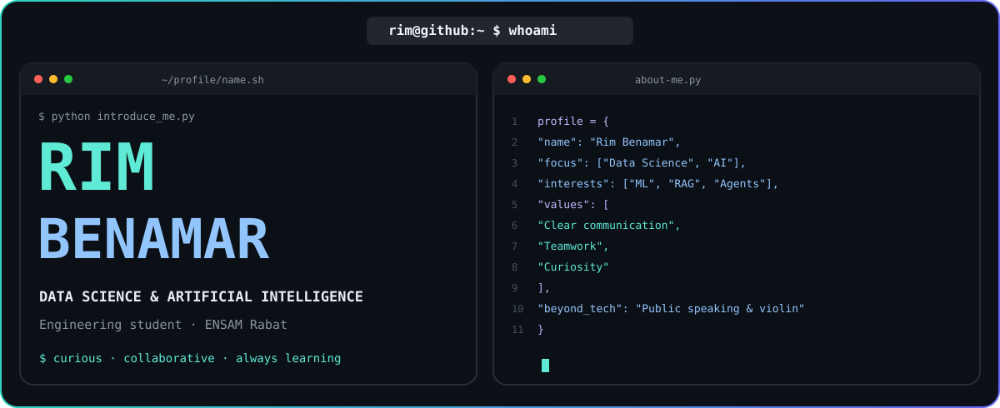

  

  <a href="https://www.linkedin.com/in/rim-benamar/">LinkedIn</a>
  &nbsp;·&nbsp;
  <a href="mailto:r.rimbenamar@gmail.com">Email</a>

<h3>A little about me</h3>

  Engineering student in <b>Data Science, AI and Digital Health at ENSAM Rabat</b>.
  I enjoy working with data, exploring intelligent systems and making technical
  ideas clear and useful.

  Communication and teamwork are central to how I work. Through student leadership,
  partner relations and Model United Nations, I've developed my public speaking,
  coordination and listening skills. Outside tech, I play the violin.

<h3>Technical toolkit</h3>

<h4>Data & Machine Learning</h4>

  

SQL · Pandas · NumPy · Scikit-learn · NLP · Data quality

<h4>Generative AI</h4>

  
  
  
  
  
  

<h4>Visualization & Development</h4>

  

  
  
  

 

  Analytical thinking. Clear communication. A collaborative mindset.

